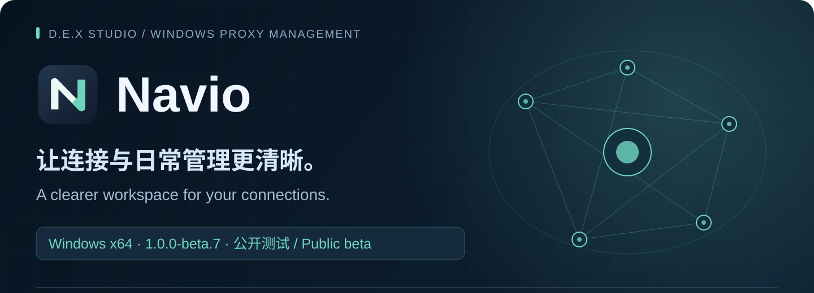
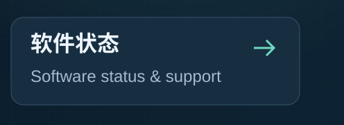
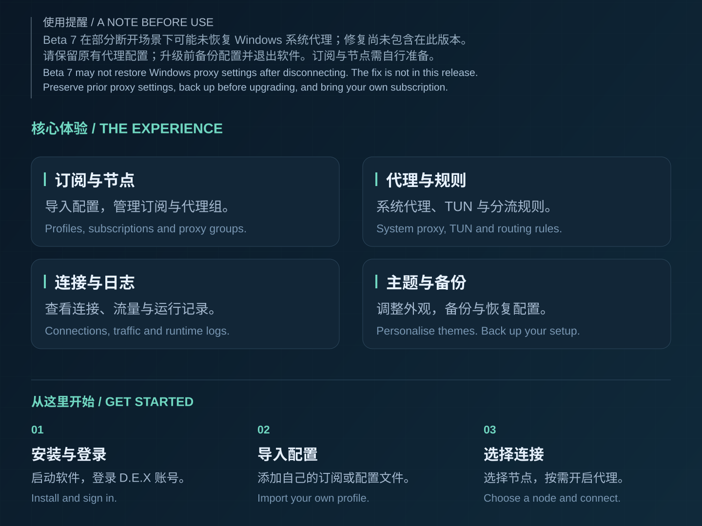

展开使用说明与链接 / Read details & links

> **Beta 7 使用提醒 / Before you use Beta 7**  
> 部分断开场景下，Windows 系统代理可能未恢复；相关修复尚未包含在当前安装包中。遇到问题请核对 Windows 代理设置，保留连接前已有的代理配置。  
> System proxy restoration may fail after disconnecting. The fix is not included in these binaries; check Windows proxy settings and preserve any pre-existing configuration.

Navio 不提供代理线路，订阅或配置需自行准备。升级前请备份配置并从托盘退出软件。  
Bring your own subscription or profile. Back up settings and quit from the system tray before upgrading.

[中文指南](https://github.com/dex-ovo-studio/Navio/blob/main/docs/guide.md) · [简体中文](https://github.com/dex-ovo-studio/Navio/blob/main/README.md) · [更新日志 / Changelog](https://github.com/dex-ovo-studio/Navio/blob/main/CHANGELOG.md) · [问题反馈 / Feedback](https://github.com/dex-ovo-studio/Navio/issues)

文字版介绍与常用链接 / Accessible overview & links

Windows x64 · 1.0.0-beta.7 · 公开测试 / Public beta

- **订阅与节点**：导入配置，管理订阅与代理组。 Profiles, subscriptions and proxy groups.
- **代理与规则**：系统代理、TUN 与分流规则。 System proxy, TUN and routing rules.
- **连接与日志**：查看连接、流量与运行记录。 Connections, traffic and runtime logs.
- **主题与备份**：调整外观，备份与恢复配置。 Personalise themes. Back up your setup.

- [版本与下载 / Release notes & downloads](https://github.com/dex-ovo-studio/Navio/releases/tag/v1.0.0-beta.7)
- [使用指南 / Installation & user guide](https://github.com/dex-ovo-studio/Navio/blob/main/docs/guide.md)
- [软件状态 / Software status & support](https://github.com/dex-ovo-studio/DEX-Studio-Software-Status)

来源、许可与参与开发 / Credits, licence & contributing

Navio 由 D.E.X Studio 开发，基于 [Clash Party](https://github.com/mihomo-party-org/clash-party) 与 [Mihomo](https://github.com/MetaCubeX/mihomo)，采用 [GPL-3.0-only](https://github.com/dex-ovo-studio/Navio/blob/main/LICENSE)。

[第三方声明](https://github.com/dex-ovo-studio/Navio/blob/main/DEX-THIRD-PARTY-NOTICES.txt) · [对应源码](https://github.com/dex-ovo-studio/Navio/tree/main) · [构建与贡献](https://github.com/dex-ovo-studio/Navio/blob/main/CONTRIBUTING.md) · [安全报告](https://github.com/dex-ovo-studio/Navio/blob/main/SECURITY.md)

