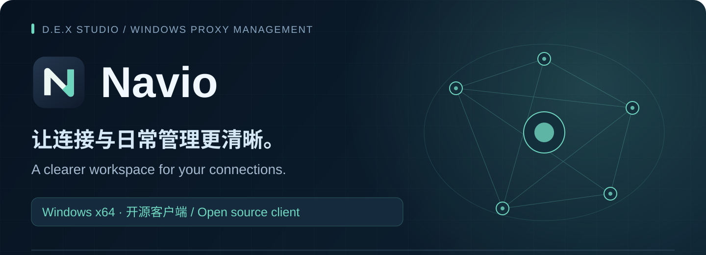
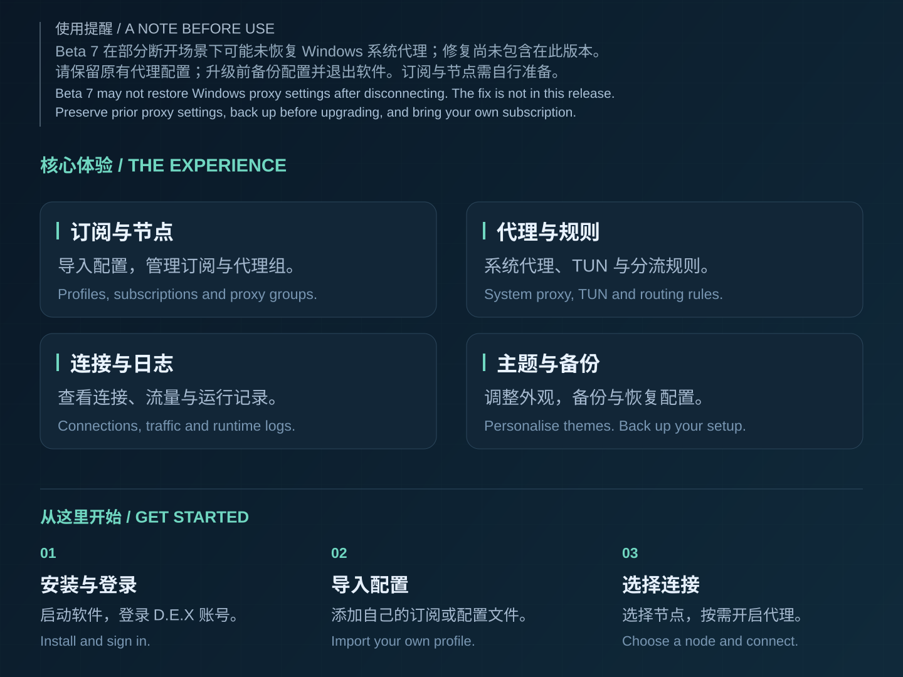

<picture>
  <source media="(max-width: 640px)" srcset="https://raw.githubusercontent.com/dex-ovo-studio/Navio/main/.github/assets/ui/v4/hero-mobile.svg" />
  
</picture>

# Navio

Windows x64 · 网络连接与代理管理 · GPL-3.0-only

**[查看所有版本 / Browse versions](https://github.com/dex-ovo-studio/Navio/releases)** · **[English](#english)**

## 选择 Windows 版本

在[版本列表](https://github.com/dex-ovo-studio/Navio/releases)中选择要安装的版本，打开该版本的发行说明和附件。Beta 与 RC 都是预发布版本。安装、升级或回退前请先备份配置。

### Beta 7

[Beta 7 下载与发行说明](https://github.com/dex-ovo-studio/Navio/releases/tag/v1.0.0-beta.7) · [安装与校验指南](https://github.com/dex-ovo-studio/Navio/blob/main/docs/install.md)

- [安装版 EXE](https://github.com/dex-ovo-studio/Navio/releases/download/v1.0.0-beta.7/Navio-v1.0.0-beta.7-Windows-x64-setup.exe) — 运行安装程序。
- [便携版 ZIP](https://github.com/dex-ovo-studio/Navio/releases/download/v1.0.0-beta.7/Navio-v1.0.0-beta.7-Windows-x64-portable.zip) — 完整解压后运行 `Navio.exe`。
- [SHA-256 清单](https://github.com/dex-ovo-studio/Navio/releases/download/v1.0.0-beta.7/SHA256SUMS-rev2.txt) — 运行前核对所选文件。

> [!IMPORTANT]
> **Beta 7 已知问题：** 断开后，Windows 系统代理有时不会恢复。连接前记下原代理设置。若断开后无法正常联网，先从托盘退出 Navio，再到 **设置 → 网络和 Internet → 代理**恢复原设置，然后检查能否联网。

## 功能范围

- **订阅与节点：** 导入配置，管理订阅和代理组。
- **代理与规则：** 系统代理、TUN 与分流规则，具体支持情况和权限要求以所选版本为准。
- **连接与日志：** 查看连接、流量和运行记录。
- **外观与备份：** 主题设置、配置备份与恢复。

所选版本的功能、权限要求和已知限制见发行说明。

品牌与功能示意（非应用截图） / Brand illustration (not an app screenshot)

此图用于介绍品牌与功能组织，**不是应用运行截图**。本页暂未收录经核验的真实产品截图，实际界面以所选发行版本为准。

This illustration presents the brand and feature layout. **It is not a screenshot of the running app.** This page does not yet include verified product screenshots; the interface may vary by release.

## 使用与支持

- [安装、升级与文件校验](https://github.com/dex-ovo-studio/Navio/blob/main/docs/install.md)
- [项目维护状态](https://github.com/dex-ovo-studio/DEX-Studio-Software-Status)
- [常见问题](https://github.com/dex-ovo-studio/Navio/blob/main/docs/faq.md)
- [详细使用指南](https://github.com/dex-ovo-studio/Navio/blob/main/docs/guide.md)
- [问题反馈与功能建议](https://github.com/dex-ovo-studio/Navio/issues)
- [安全报告](https://github.com/dex-ovo-studio/Navio/blob/main/SECURITY.md)
- [贡献指南](https://github.com/dex-ovo-studio/Navio/blob/main/CONTRIBUTING.md)
- [English — 本页英文说明](#english)

Navio **不提供代理线路或订阅服务**。请自行准备合法的配置和服务，并遵守所在地适用规定。

## 开源许可与致谢

Navio 由 **D.E.X Studio** 开发，基于 [Clash Party](https://github.com/mihomo-party-org/clash-party) 和 [Mihomo](https://github.com/MetaCubeX/mihomo)，采用 **GPL-3.0-only** 许可证。

[GPL 许可证](https://github.com/dex-ovo-studio/Navio/blob/main/LICENSE) · [第三方声明](https://github.com/dex-ovo-studio/Navio/blob/main/DEX-THIRD-PARTY-NOTICES.txt) · [项目源码（main）](https://github.com/dex-ovo-studio/Navio/tree/main)

[Beta 7 源码归档](https://github.com/dex-ovo-studio/Navio/releases/download/v1.0.0-beta.7/Navio-v1.0.0-beta.7-source-rev2.zip) · [随发行版提供的第三方源码归档](https://github.com/dex-ovo-studio/Navio/releases/download/v1.0.0-beta.7/Navio-v0.3-v0.6-third-party-sources.zip) · [按版本查找对应源码与校验清单](https://github.com/dex-ovo-studio/Navio/blob/main/CHANGELOG.md)

---

## English

Navio is an open-source Windows x64 client for managing network connections, proxy configurations and subscriptions.

**[Browse Windows versions](https://github.com/dex-ovo-studio/Navio/releases)** · **[中文](#navio)**

Choose a version from the release list and read its notes before opening the attached files. Beta and RC builds are prereleases. Back up your configuration before installing, upgrading or rolling back.

### Beta 7 for Windows x64

[Beta 7 release notes and downloads](https://github.com/dex-ovo-studio/Navio/releases/tag/v1.0.0-beta.7) · [Installation and verification guide](https://github.com/dex-ovo-studio/Navio/blob/main/docs/install.md)

- [EXE installer](https://github.com/dex-ovo-studio/Navio/releases/download/v1.0.0-beta.7/Navio-v1.0.0-beta.7-Windows-x64-setup.exe) — Run the installer.
- [Portable ZIP](https://github.com/dex-ovo-studio/Navio/releases/download/v1.0.0-beta.7/Navio-v1.0.0-beta.7-Windows-x64-portable.zip) — Extract the entire archive, then run `Navio.exe`.
- [SHA-256 checksums](https://github.com/dex-ovo-studio/Navio/releases/download/v1.0.0-beta.7/SHA256SUMS-rev2.txt) — Verify your file before running it.

> [!IMPORTANT]
> **Beta 7 known issue:** Windows may keep the system proxy after disconnecting. Note your proxy settings before connecting. If internet access fails after disconnecting, quit Navio from the system tray, restore your previous settings under **Settings → Network & internet → Proxy**, and check your connection.

### Feature scope

- Import configurations and manage subscriptions, nodes and proxy groups.
- Manage system proxy settings, TUN and routing rules where supported by the selected release.
- View connections, traffic and application logs.
- Customize themes and back up or restore configurations.

Check the release notes for availability, required permissions and known limitations.

### Documentation and support

[Install and verify](https://github.com/dex-ovo-studio/Navio/blob/main/docs/install.md) · [FAQ](https://github.com/dex-ovo-studio/Navio/blob/main/docs/faq.md) · [Maintenance status](https://github.com/dex-ovo-studio/DEX-Studio-Software-Status) · [Full user guide (Chinese)](https://github.com/dex-ovo-studio/Navio/blob/main/docs/guide.md) · [Bug reports and feature requests](https://github.com/dex-ovo-studio/Navio/issues) · [Security reports](https://github.com/dex-ovo-studio/Navio/blob/main/SECURITY.md) · [Contributing](https://github.com/dex-ovo-studio/Navio/blob/main/CONTRIBUTING.md)

Navio **does not provide proxy servers or subscriptions**. Supply your own lawful configuration and service, and follow applicable local requirements.

### License and credits

Developed by **D.E.X Studio**, Navio is based on [Clash Party](https://github.com/mihomo-party-org/clash-party) and [Mihomo](https://github.com/MetaCubeX/mihomo). It is licensed under **GPL-3.0-only**.

[License](https://github.com/dex-ovo-studio/Navio/blob/main/LICENSE) · [Third-party notices](https://github.com/dex-ovo-studio/Navio/blob/main/DEX-THIRD-PARTY-NOTICES.txt) · [Project source (main)](https://github.com/dex-ovo-studio/Navio/tree/main)

[Beta 7 source archive](https://github.com/dex-ovo-studio/Navio/releases/download/v1.0.0-beta.7/Navio-v1.0.0-beta.7-source-rev2.zip) · [Third-party source archive listed in the release](https://github.com/dex-ovo-studio/Navio/releases/download/v1.0.0-beta.7/Navio-v0.3-v0.6-third-party-sources.zip) · [Source archives and checksums by version](https://github.com/dex-ovo-studio/Navio/blob/main/CHANGELOG.md)

---

© 2026 D.E.X Studio · Navio · GPL-3.0-only

