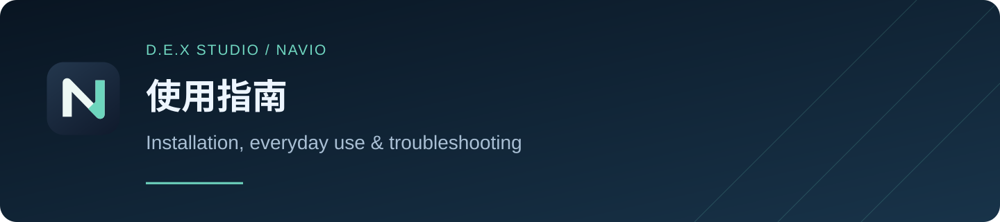

[返回 Navio](https://github.com/dex-ovo-studio/Navio) · [下载](https://github.com/dex-ovo-studio/Navio/releases/tag/v1.0.0-beta.7) · [问题反馈](https://github.com/dex-ovo-studio/Navio/issues)

## 安装与启动

在 [Beta 7 发行页](https://github.com/dex-ovo-studio/Navio/releases/tag/v1.0.0-beta.7)下载当前 Windows x64 公开测试版。运行前请按[安装与校验指南](install.md)核对文件。

- **安装版**：运行文件名以 `setup.exe` 结尾的安装包。
- **免安装版**：完整解压 `portable.zip`，再运行 `Navio.exe`。不要单独移动程序文件。

安装前从托盘退出旧版。安装目录和 Windows 临时目录所在磁盘都需要足够空间；不要将安装版装入免安装版目录。

## 配置连接

登录 D.E.X 账号后导入自己的订阅或配置，选择代理组和节点，再开启系统代理或 TUN。账号不包含代理线路。

系统代理主要用于遵循系统代理设置的应用；TUN 可用于需要虚拟网卡接管的连接。首次启用 TUN 时，按提示安装后台服务或选择本次管理员运行。关闭窗口会收起到托盘，退出程序请使用托盘菜单。

## 更新与备份

可在软件内检查并下载更新。更新会暂时中断连接，请先保存正在进行的工作。

从 `0.6.0-beta.5` 或更早版本升级时，先退出旧版，再手动安装。免安装版应解压到新目录，将旧版的 `DEX-STUDIO-NEXT` 数据目录复制过去，不要同时运行新旧版本。

| 版本     | 本机数据位置                       |
| -------- | ---------------------------------- |
| 安装版   | `%APPDATA%\DEX-STUDIO-NEXT`        |
| 免安装版 | `Navio.exe` 旁的 `DEX-STUDIO-NEXT` |

卸载安装版会保留配置。从免安装版切换到安装版，建议通过软件的本地备份导出和恢复，随后重新登录。加密备份需要原备份密码才能恢复。

## 常见问题

### 断开后系统代理未恢复

Beta 7 断开后有时会保留 Windows 系统代理。若断开后无法联网，请按[常见问题](faq.md)中的步骤恢复连接前的设置。

### 没有可用节点

确认已导入有效订阅，更新订阅后重新选择节点。Navio 不提供订阅。

### 提示缺少规则数据库

在“外部资源”下载所需数据库，完成后按需重启内核。下载需要能够访问相应资源来源。

### 无法登录

检查网络和账号服务状态。可用的登录方式以登录页为准。已登录设备在账号服务暂不可用时可继续使用本地配置，在线功能需等待服务恢复。

### 删除免安装目录后仍有 TUN 服务

后台服务单独安装。请在软件的 TUN 设置中卸载，或在 Windows“已安装的应用”中卸载 Navio TUN Service。

## 问题反馈

在 [Issues](https://github.com/dex-ovo-studio/Navio/issues) 提供软件版本、Windows 版本、复现步骤和错误提示。上传日志或截图前，请移除订阅地址、节点密码、令牌和账号信息。安全漏洞请按 [SECURITY.md](../SECURITY.md) 报告。
